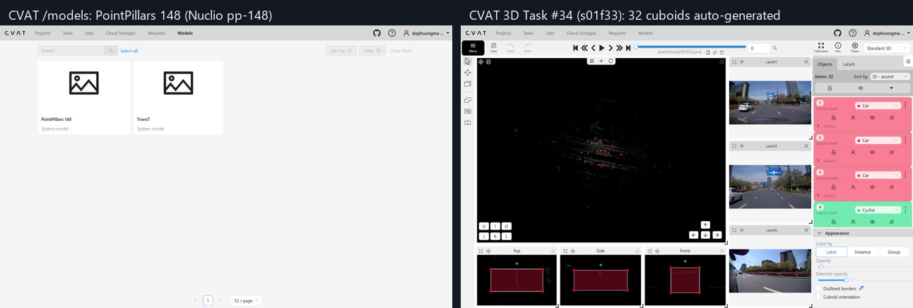

# Bonus Hướng 2 — PointPillars chạy trong CVAT qua Nuclio (`pp-148`)

Thư mục này chứa mã nguồn Nuclio serverless function `pp-148` (`function.yaml` và `main.py`) bọc mô hình PointPillars (`vf_pp`) để chạy trực tiếp trong CVAT Docker cục bộ (`http://localhost:8080`).

## 1. Chuẩn bị & Deploy

Khi deploy, ghép thêm bản sao `vf_pp/` và `third_party/PointPillars/{pointpillars,pretrained}` vào cùng thư mục tạm (không commit `third_party/` lên Git), rồi chạy `nuctl` (phiên bản `1.16.3` khớp image `quay.io/nuclio/dashboard:1.16.3-amd64`):

```bash
nuctl create project cvat --platform local
nuctl deploy --project-name cvat --path /tmp/pp-148 \
  --file /tmp/pp-148/function.yaml --platform local \
  --env CVAT_FUNCTIONS_REDIS_HOST=cvat_redis_ondisk \
  --env CVAT_FUNCTIONS_REDIS_PORT=6666
nuctl get functions --platform local
# nuclio | pp-148 | cvat | ready | 1/1
```

## 2. Gọi auto-annotation qua API CVAT

Vì giao diện Automatic annotation của CVAT khóa danh sách model cho task 3D, gọi trực tiếp API trên task 3D riêng (`D14-148-Nuclio-Test`, `task=34`, gồm 3 frame tập A):

```bash
curl -u "<CVAT_USER>:<CVAT_PASSWORD>" -H "Content-Type: application/json" \
  -X POST http://localhost:8080/api/lambda/requests \
  -d '{"function": "pp-148", "task": 34, "threshold": 0.1, "cleanup": true}'
```

## 3. Kết quả so khớp với `d14_148/pred_A.json` offline

Trích xuất cuboid qua `GET /api/jobs/34/annotations` (không dùng export để tránh lỗi `cvat#9144`), đếm cặp hộp cùng lớp có khoảng cách tâm ngang ≤ 0,5 m:

| Frame | Box CVAT (`pp-148`, `thr=0.1`) | Box offline (`pred_A.json`) | Trùng tâm ≤ 0,5 m | Ghi chú |
|---|---:|---:|---:|---|
| `s01f33` | 32 | 32 | 27 | Lệch 5 hộp nhiễu điểm tin cậy thấp do lượng tử hóa 8-bit `intensity_gray` trong PCD |
| `s03f00` | 20 | 20 | 20 | Khớp 20/20 (100%) |
| `s05f03` | 30 | 32 | 30 | Toàn bộ 30 hộp CVAT đều khớp offline; 2 hộp điểm tin cậy thấp lệch dưới ngưỡng do xấp xỉ intensity |
| **Tổng** | **82** | **84** | **77** | **77/84 (91,7%) khớp trong 0,5 m** (không giống hệt 100% do khôi phục intensity xấp xỉ từ kênh `rgb` của PCD) |

## 4. Video demo & ảnh chụp CVAT

- Video demo ngắn (`1280×840`, H.264, 21,5 giây, không chứa thông tin đăng nhập): [`demo_pp148.mp4`](demo_pp148.mp4)
- Ảnh xem trước (trang `/models` hiện `PointPillars 148` và khung 3D `s01f33` với 32 cuboid tự sinh): [`preview_pp148.jpg`](preview_pp148.jpg)


