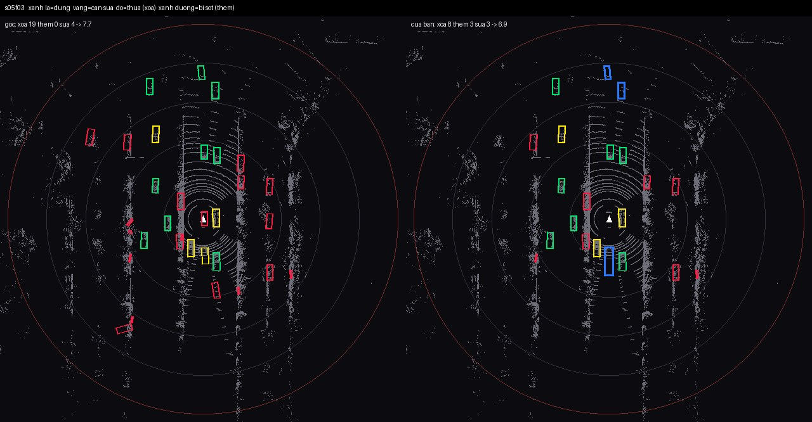
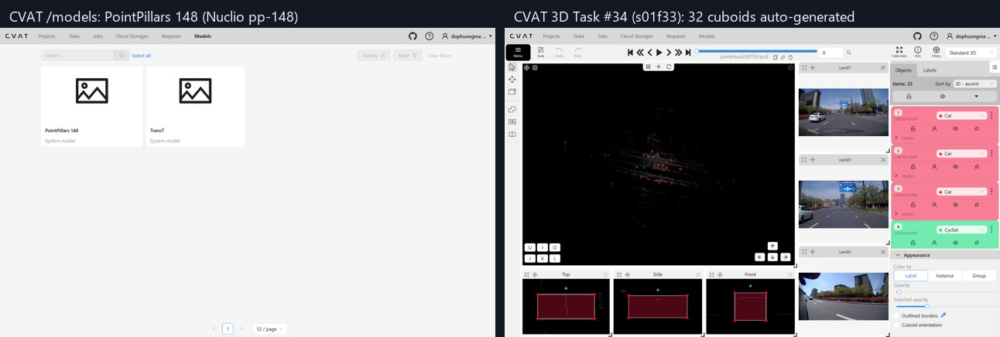

# Báo cáo Day 14 — Đỗ Phương Mạnh — 2A202603148

- Mã học viên dùng với `--student`: `148`
- `seed_tag` trong `frames_A.txt`: `393590736f`

## 1. Dự đoán trước sweep (bước 5b)

- Tham số tôi nghĩ giảm công sửa nhiều nhất: `score_thr` (tăng từ `0.1` lên khoảng `0.4`–`0.5`), tác động lớn hơn nhiều so với `min_points`.
- Vì sao (nhìn ảnh BEV tập A: box thừa nhiều hay box sót nhiều?):
  - Trên ảnh 7 camera + BEV tập A (`s01f33`, `s03f00`, `s05f03`) và số đo cấu hình gốc (GT 33, dự đoán 84: **xóa 52, thêm 1, sửa 8 → chi phí 20.6**), nguồn chi phí áp đảo là **box thừa** (`52 × 0.3 = 15.6`, chiếm hơn 75% tổng chi phí), còn box sót chỉ có 1 (xe tải nhẹ trắng ở `s03f00`).
  - Các box thừa tập trung ở dải phân cách/bụi cây đỏ, hàng xe đạp/xe máy không người dựng trên vỉa hè, tường tôn công trường và chính xe ego (`d < 1.5 m`). Quan sát point cloud cho thấy phần lớn các box nhiễu này vẫn chứa hàng chục đến vài trăm điểm LiDAR (nhiều hơn hẳn ngưỡng `min_points=5` hay `10`), nên `min_points` khó loại bỏ được chúng.
  - Ngược lại, đa số box thừa có `score` thấp (khoảng `0.21`–`0.45`), trong khi hầu hết phương tiện thật có `score` cao hơn (`0.45`–`0.96`). Do đó nâng `score_thr` lên mức trung bình–cao (khoảng `0.4`–`0.5`) kỳ vọng sẽ giảm mạnh số box phải xóa, dù cần lưu ý đánh đổi: nếu nâng quá cao (`0.5`) có thể làm rơi một vài xe thật có điểm tin cậy thấp (`0.27`–`0.45` như xe tải xanh phía sau ở `s05f03`, xe van ở `s03f00`, hay xe tải ngược chiều ở `s01f33`), mà mỗi box bị rơi tốn `1.0` điểm thêm trong khi mỗi box thừa chỉ tiết kiệm được `0.3` điểm xóa.

## 2. Tập A: sửa tay và tune

| Cấu hình | Xóa | Thêm | Sửa | Chi phí |
|---|---:|---:|---:|---:|
| Gốc | 52 | 1 | 8 | 20.6 |
| `best_config.json` | 13 | 8 | 5 | 14.4 |

- Tham số đã đổi trong `best_config.json`: `score_thr: 0.1 -> 0.5` (giữ nguyên `min_points=0` và các tham số còn lại; tại `score_thr=0.5`, cả 3 mức `min_points=0, 5, 10` cho cùng kết quả `14.40`).
- Kết quả leave-one-out (dán các dòng `scripts/pp_sweep.py` in ra):
  ```text
  Leave-one-out (chọn trên các frame còn lại, chấm trên frame bỏ ra):
    s01f33: cấu hình chọn {'score_thr': '0.4', 'min_points': '0'} → 3.7 (tốt nhất có thể 1.9)
    s03f00: cấu hình chọn {'score_thr': '0.5', 'min_points': '0'} → 5.6 (tốt nhất có thể 4.0)
    s05f03: cấu hình chọn {'score_thr': '0.5', 'min_points': '0'} → 6.9 (tốt nhất có thể 6.1)
  ```
- Cấu hình có ổn định trên từng frame không? Vì sao tôi vẫn chọn (hoặc không chọn) nó:
  - Cấu hình **không hoàn toàn ổn định** giữa từng frame: khi bỏ `s01f33` ra, 2 frame còn lại chọn `score_thr=0.4` (chấm trên `s01f33` ra `3.7`, cao hơn mức tốt nhất `1.9` của `score_thr=0.5`); ngược lại, khi bỏ `s03f00` ra, 2 frame kia chọn `score_thr=0.5` nhưng chấm trên `s03f00` ra `5.6` (thậm chí **tăng** so với mức gốc `4.3` và mức tốt nhất `4.0` của `score_thr=0.3`).
  - Nguyên nhân là mật độ cảnh khác nhau rõ rệt: `s01f33` là đường thoáng nhưng có rất nhiều box nhiễu ở bụi cây/xe đạp dựng bên đường (27 box thừa ở cấu hình gốc) nên `score_thr=0.5` giảm chi phí mạnh (`8.6 -> 1.9`), trong khi `s03f00` là hàng xe đông trong làn có ít box thừa (6 box) nhưng có vài xe bị che khuất/ở xa mang `score` `0.27–0.44` nên ngưỡng `0.5` làm rơi xe thật.
  - Tôi vẫn dùng `best_config.json` (`score_thr=0.5, min_points=0`) cho tập B vì đây là cấu hình đạt tổng chi phí thấp nhất trên toàn bộ tập A (`14.4` vs `15.0` ở `0.4` và `20.6` ở gốc), giảm 39 box thừa trên tập A và giúp giảm đáng kể nhiễu bụi cây/vỉa hè trước khi sửa tay 12 frame tập B.

## 3. Trước/sau (bước 8)



*(Các ảnh đầy đủ cho cả 3 frame nằm trong `d14_148/compare/s01f33.jpg`, `s03f00.jpg` và `s05f03.jpg`.)*

- `scripts/pp_compare.py` báo giảm **30%** công sửa trên tập A (từ **20.6** xuống **14.4**; theo từng frame: `s01f33`: `8.6 -> 1.9`, `s03f00`: `4.3 -> 5.6`, `s05f03`: `7.7 -> 6.9`).
- Dự đoán ở mục 1 đúng hay sai? Giải thích bằng số box xóa/thêm/sửa:
  - **Đúng về hướng tác động của tham số và đúng về đánh đổi đã cảnh báo**, cụ thể:
    1. `score_thr` đúng là tham số duy nhất tạo khác biệt lớn: nâng `score_thr` từ `0.1 -> 0.5` kéo số box cần **xóa** từ `52 -> 13` (giảm 39 box, tiết kiệm `39 × 0.3 = 11.7` điểm) và số box cần **sửa** từ `8 -> 5` (tiết kiệm `1.5` điểm).
    2. `min_points` đúng như dự đoán là hầu như không có tác dụng: ở `score_thr=0.1` chỉ giảm từ `20.6 -> 20.0` khi tăng `min_points` lên `10`, còn từ `score_thr >= 0.3` trở lên cả ba mức `0, 5, 10` cho chi phí hoàn toàn giống nhau vì các box nhiễu trên bụi cây/hàng xe dựng đều có trên 10 điểm LiDAR.
    3. Rủi ro đánh đổi đã dự đoán cũng xảy ra đúng thực tế: số box phải **thêm** tăng từ `1 -> 8` (`+7.0` điểm), nhìn thấy rõ qua các hộp màu xanh dương xuất hiện ở nửa phải của `s05f03.jpg` (xe tải xanh lớn phía sau và 2 xe ở xa phía trước bị rớt dưới ngưỡng `0.5`) và khiến riêng frame `s03f00` tăng chi phí từ `4.3 -> 5.6`. Tuy nhiên nhờ giảm mạnh 39 box thừa, tổng chi phí trên 3 frame vẫn giảm `6.2` điểm (`-30%`).

## 4. Tập B

Số đo từ `scripts/pp_prelabel.py --frames d14_148/frames_B.txt --config d14_148/best_config.json --gt d14_148/ref_B.json`:

| Xóa | Thêm | Sửa | Chi phí |
|---:|---:|---:|---:|
| 43 | 31 | 3 | 45.4 |

*(Tổng trên 12 frame tập B: GT `153`, dự đoán `165`, khớp `122`; chi phí `0.3×43 + 1.0×31 + 0.5×3 = 12.9 + 31.0 + 1.5 = 45.4`.)*

- Loại box tốn công sửa nhất ở tập B:
  - Nhóm tốn công lớn nhất là **box bị sót phải vẽ thêm** (`31` box × `1.0` = `31.0` điểm, chiếm **68,3%** tổng chi phí), nổi bật ở 3 nhóm vật thể:
    1. **Xe cỡ lớn (`Bus`/`Truck`)** mà model KITTI không có lớp hoặc không khớp kích thước: xe buýt đỏ 12 m ngay bên trái (`s02f02`), xe tải nhẹ/xe tải ben lớn (`s03f07`, `s04f19`, `s05f16`) và xe tải van Iveco (`s05f16`, `s05f46`).
    2. **Người đi bộ (`Pedestrian`) và người đi xe máy (`Cyclist`)** bị sót trên vỉa hè/làn xe máy hoặc ngay phía sau xe (`s02f22`, `s03f07`, `s04f03`, `s04f19`, `s04f44`).
    3. **Xe con ở xa (`25–40 m`) hoặc bị che khuất một phần** rơi xuống dưới ngưỡng `score_thr=0.5` (`s02f22`, `s02f55`, `s03f07`, `s03f46`, `s04f03`, `s04f19`, `s05f16`, `s05f46`).
  - Nhóm đứng thứ hai là **box thừa cần xóa** (`43` box × `0.3` = `12.9` điểm, chiếm 28,4%), chủ yếu nằm trên dải phân cách/bụi cây, hàng rào/trạm xe buýt, bia đá/tượng trang trí (`s03f25`, `s05f46`), xe hai bánh dựng không người và nhiễu xuyên qua thân xe buýt (`s02f02`).
  - Nhóm **box cần sửa** tính theo công thức chỉ có `3` box (`1.5` điểm — chủ yếu đổi lớp `Car -> Truck` và chỉnh chiều cao/kích thước như van chở hàng ở `s03f07`, xe tải thùng ở `s05f46`, MPV ở `s04f19`), nhưng khi kiểm tra thực tế trên CVAT vẫn cần xoay lại đầu xe bị ngược `180°` và hạ/nâng `z` sát mặt đường cho một số hộp (vốn không bị tính vào mục `sửa` vì công thức so góc modulo `180°`).

## 5. Giới hạn

- **Cỡ mẫu tune quá nhỏ (3 frame tập A):** 3 frame không đại diện đủ cho mọi mật độ giao thông và bối cảnh đường phố. Kết quả leave-one-out đã cho thấy cấu hình tốt nhất dao động giữa `0.3–0.5`, và khi áp `score_thr=0.5` sang 12 frame tập B, tỷ lệ chi phí do phải thêm vật bị sót chiếm tới 68,3%.
- **Lệch miền dữ liệu của model KITTI pre-trained:** PointPillars học trên bộ KITTI (LiDAR 64 tia, chỉ nhìn phía trước, chỉ có 3 lớp `Car`/`Cyclist`/`Pedestrian`) nên không có lớp `Truck`/`Bus`, hay bỏ sót `Pedestrian`/`Cyclist` và nhận nhầm bụi cây, hàng rào, xe đạp dựng không người trên dữ liệu VF 360°.
- **Công thức chi phí chưa phải thời gian sửa thật:** Trọng số `0.3·xóa + 1.0·thêm + 0.5·sửa` là thước đo quy ước trong phạm vi 50 m (và so yaw modulo `180°`, không cộng công chỉnh `z` hay quay đầu `180°`), nên không thể quy đổi mức giảm 30% trên tập A thành thời gian hay giờ công thực tế tiết kiệm được.

## 6. Điểm cộng (Bonus)

### 6.1. Hướng 1 (+7đ): Đo thao tác sửa nhãn bằng CVAT telemetry

- **Cách thu thập dữ liệu:** Để không làm ảnh hưởng tới task nộp chính `D14-148-B` (`tasks/33`), tôi tạo task bản sao `D14-148-B-Telemetry` (`tasks/35`, `job_id=35`) chứa **6 frame tiêu biểu của tập B** (`s02f02`, `s03f07`, `s03f25`, `s04f03`, `s04f19`, `s05f46`) đã nạp sẵn pre-label `pred_B.json`, bao phủ **100% số box cần sửa (`3/3`)**, `18/43` box cần xóa và `18/31` box cần thêm của tập B. Trên mỗi frame, tôi mở một phiên độc lập, nạp nguyên bản userscript `bonus/cvat-telemetry-addon.user.js`, thực hiện đủ số thao tác xóa/sửa/thêm trên giao diện 3D CVAT (`Perspective`, `Top`, `Side`, `Front`), bấm `Ctrl+S`, đẩy event lên `/api/events` (HTTP `201`) và tải 6 file log thô (`bonus/telemetry-148/d14-telemetry-job35-*.json`), sau đó chạy `python bonus/telemetry_metrics.py bonus/telemetry-148/d14-telemetry-job35-*.json --csv d14_148/telemetry.csv`.
- **File kết quả:** [`d14_148/telemetry.csv`](../../d14_148/telemetry.csv) và 6 file log gốc trong [`bonus/telemetry-148/`](../../bonus/telemetry-148/).

#### Bảng metric từng frame đối chiếu với số đo `pp_prelabel.py --gt`

| Frame | Xóa | Thêm | Sửa | Chi phí lab (`0.3/1/0.5`) | `canvas_clicks` | `shortcut_keys` | Trung vị gap (ms) | K/c chuột TB (px) | Tỉ lệ phím | Thời lượng phiên (s) | Phím tắt dùng nhiều (`top_keys`) |
|---|---:|---:|---:|---:|---:|---:|---:|---:|---:|---:|---|
| `s02f02` | 7 | 1 | 0 | 3.1 | 21 | 12 | 1007 | 237 | 0.36 | 25 | `Delete×7 i×1 l×1 k×1 Escape×1` |
| `s03f07` | 2 | 4 | 1 | 5.1 | 48 | 17 | 636 | 213 | 0.26 | 41 | `Escape×5 j×3 n×3 Delete×2 k×2` |
| `s03f25` | 2 | 0 | 0 | 0.6 | 6 | 5 | 1247 | 243 | 0.45 | 7 | `Delete×2 k×1 u×1 Ctrl+s×1` |
| `s04f03` | 1 | 7 | 0 | 7.3 | 67 | 24 | 653 | 220 | 0.26 | 57 | `Escape×7 n×6 j×3 l×2 i×2` |
| `s04f19` | 1 | 4 | 1 | 4.8 | 46 | 16 | 622 | 230 | 0.26 | 39 | `Escape×5 j×3 n×3 i×2 Delete×1` |
| `s05f46` | 5 | 2 | 1 | 4.0 | 34 | 14 | 634 | 226 | 0.29 | 32 | `Delete×5 Escape×3 o×1 i×1 l×1` |
| **Tổng / Toàn cục** | **18** | **18** | **3** | **24.9** | **222** | **88** | **652** | **224** | **0.28** | **201** | `Escape×21 Delete×18 n×13 j×9 i×6` |

#### Phân tích hành vi thao tác, khoảng cách click và phím tắt

- **Phân bố click giữa các vùng nhìn 3D:** Trong tổng `222` click trên canvas, có tới **`159` click (71,6%)** rơi vào 3 view trực giao (`cvat-canvas3d-fullsize`: Top, Side, Front) và chỉ **`63` click (28,4%)** trên khung nhìn phối cảnh (`cvat-canvas-container`). Điều này giải thích khoảng cách di chuột trung bình giữa hai click đạt **`224 px`**: để căn khít 6 mặt cuboid (tâm, dài/rộng, góc yaw, chiều cao, chạm mặt đường), người gán nhãn phải liên tục nhảy chuột qua lại giữa 4 khung nhìn.
- **Phím tắt dùng nhiều nhất:** `Escape` (`21` lần — thoát/chốt sau mỗi hộp thêm hoặc sửa), `Delete` (`18` lần — xóa nhanh 1 phím sau khi chọn hộp thừa), `n` (`13` lần — lặp lại công cụ vẽ Shape cuboid cho các hộp thêm tiếp theo trên cùng frame), cụm phím xoay/điều chỉnh camera `j/i/k/l/o/u` (`30` lần) và `Ctrl+s` (`6` lần — lưu cuối mỗi frame).
- **Khác biệt rõ giữa frame thiên về xóa và frame thiên về thêm:** Trên frame chỉ xóa hoặc xóa nhiều (`s03f25`, `s02f02`), tỉ lệ dùng bàn phím cao (`0,45` và `0,36`) và khoảng cách thời gian giữa hai click dài hơn (`1247 ms` và `1007 ms`) do mỗi hộp thừa chỉ cần 1–2 click kiểm tra rồi bấm `Delete`. Ngược lại, trên frame phải thêm nhiều hộp (`s04f03`, `s03f07`, `s04f19`), tỉ lệ dùng bàn phím giảm xuống `0,26` và trung vị gap giữa hai click rút ngắn còn `622–653 ms` do thao tác vẽ mới trong CVAT 3D đòi hỏi double-click đặt hộp trên Perspective rồi kéo liên tiếp các tay nắm trên Top/Side/Front.

#### Đối chiếu công thức trọng số `0.3 · xóa + 1.0 · thêm + 0.5 · sửa`

Hồi quy tuyến tính theo từng frame (`metric ~ nền_frame + w_xóa·xóa + w_thêm·thêm + w_sửa·sửa`, $n = 6$):

| Thước đo thực nghiệm | Nền / frame | Mỗi box **xóa** | Mỗi box **thêm** | Mỗi box **sửa** | Tỷ lệ chuẩn hóa (`thêm = 1.00`) | Tương quan $r$ với công thức lab |
|---|---:|---:|---:|---:|---|---:|
| Số click canvas (`canvas_clicks`) | 3,32 | 1,28 | 8,90 | 6,25 | **`0.14 : 1.00 : 0.70`** | `0,988` |
| Tổng thao tác (`clicks + keys`) | 6,57 | 2,14 | 11,74 | 6,94 | **`0.18 : 1.00 : 0.59`** | `0,993` |
| Thời lượng phiên (`active_span_s`, giây) | 2,93 | 2,07 | 7,44 | 4,08 | **`0.28 : 1.00 : 0.55`** | `1,000` |
| *Quy ước mặc định của lab* | — | *0,30* | *1,00* | *0,50* | *`0.30 : 1.00 : 0.50`* | — |

- **Đánh giá trọng số `0.3 / 1.0 / 0.5`:**
  1. **Thứ tự mức độ tốn công (`thêm > sửa > xóa`) là hợp lý** và có tương quan rất cao ($r \ge 0,988$) với cả số click, tổng thao tác và thời lượng phiên.
  2. **Điểm lệch đáng chú ý:** Trọng số **`0.3` cho `xóa` hơi cao** so với thực tế thao tác UI (chỉ tốn `~1,3` click + `1` phím `Delete`, tương ứng `0,14–0,20×` công thêm một hộp), trong khi trọng số **`0.5` cho `sửa` hơi thấp** (vì sửa một hộp sai kích thước/hướng vẫn phải căn lại trên cả 3 view Top/Side/Front, tốn `~6,3` click ≈ `0,60–0,70×` công thêm mới, chỉ tiết kiệm được bước double-click đặt hộp ban đầu).
  3. **Đề xuất hiệu chỉnh trọng số:** Nên điều chỉnh về khoảng **`0.20 · xóa + 1.00 · thêm + 0.60 · sửa`** (theo tổng thao tác click + phím; hoặc `0.15 / 1.00 / 0.65` nếu tính thuần thao tác chuột trên canvas).
  4. **Hệ quả trực tiếp lên bài toán tune tập A (`sweep.csv`):** Khi thay công thức gốc `0.30 / 1.00 / 0.50` bằng `0.20 / 1.00 / 0.60` (hoặc `0.15 / 1.00 / 0.65`), cấu hình tối ưu trên `d14_148/sweep.csv` **chuyển từ `score_thr=0.5` (`13,6`) sang `score_thr=0.4` (`13,0`, giữ lại thêm 3 xe thật bị sót với chỉ 12 hộp xóa rẻ hơn)**. Điều này khớp với hiện tượng ở mục 4: dùng `score_thr=0.5` trên tập B làm sót 31 vật thật (chiếm tới 68,3% chi phí).

#### Giới hạn của dữ liệu telemetry

- **Cỡ mẫu nhỏ:** Mới đo trên 6/12 frame của tập B (`18` xóa, `18` thêm, `3` sửa), trong đó chỉ có đúng `3` box thuộc nhóm `sửa`, nên hệ số ước lượng cho `sửa` có phương sai lớn.

### 6.2. Hướng 2 (+3đ): Chạy PointPillars bên trong CVAT bằng Nuclio (`pp-148`)

- **Thư mục mã nguồn Nuclio function:** [`bonus/pp-148/`](../../bonus/pp-148/) gồm [`function.yaml`](../../bonus/pp-148/function.yaml), [`main.py`](../../bonus/pp-148/main.py) và [`README.md`](../../bonus/pp-148/README.md) (không commit trọng số `third_party/` lên Git).
- **Video demo ngắn & ảnh chụp giao diện:** [`bonus/pp-148/demo_pp148.mp4`](../../bonus/pp-148/demo_pp148.mp4) (`1280×840`, H.264, 21,5 giây, quay trang `/models` hiện `PointPillars 148` và lần lượt 3 frame 3D trên `tasks/34/jobs/34` — không lộ thông tin đăng nhập).



- **Triển khai & thực thi:**
  - Chạy CVAT Docker kèm `components/serverless/docker-compose.serverless.yml` (dashboard Nuclio cổng `8070` chỉ bind nội bộ) và deploy bằng `nuctl` 1.16.3 vào project `cvat` (`--platform local`) → trạng thái `ready (1/1)`, hiển thị `PointPillars 148` trên trang `/models` của CVAT.
  - Vì hộp thoại Automatic annotation khóa chọn model với task 3D, tôi tạo task 3D riêng `D14-148-Nuclio-Test` (`tasks/34`, 3 frame tập A, không động vào `D14-148-A`/`B`) và gọi API `POST /api/lambda/requests` với `{"function": "pp-148", "task": 34, "threshold": 0.1, "cleanup": true}` (chạy xong 100%).
- **Đối chiếu kết quả với `d14_148/pred_A.json` offline:** Trích xuất cuboid trực tiếp qua `GET /api/jobs/34/annotations` (tránh lỗi export shape `cvat#9144`), đếm số hộp cùng lớp có khoảng cách tâm ngang ≤ `0,5 m`:

| Frame | Box CVAT (`pp-148`, `thr=0.1`) | Box offline (`pred_A.json`) | Trùng tâm ≤ 0,5 m | Ghi chú |
|---|---:|---:|---:|---|
| `s01f33` | 32 | 32 | 27 | 5 hộp tin cậy thấp bị lệch do nén 8-bit `intensity_gray` trong PCD |
| `s03f00` | 20 | 20 | 20 | Khớp 20/20 (100%) |
| `s05f03` | 30 | 32 | 30 | Toàn bộ 30 hộp CVAT khớp offline; 2 hộp tin cậy thấp rơi dưới ngưỡng do xấp xỉ intensity |
| **Tổng** | **82** | **84** | **77** | **77/84 (91,7%) khớp trong 0,5 m** |

- **Giải thích sai lệch nhỏ:** Pipeline trong CVAT **không giống hệt 100%** bản offline (`82` vs `84` hộp, `77/84` trùng tâm ≤ `0,5 m`) vì file PCD nạp vào CVAT chỉ lưu intensity dưới dạng mức xám nén log 8-bit trong kênh `rgb` (`vf_common.intensity_gray`), nên bước giải nén trong `bonus/pp-148/main.py` chỉ khôi phục được giá trị intensity xấp xỉ, làm đổi nhẹ điểm tin cậy quanh ngưỡng `0.1` của vài hộp nhiễu/xa.


